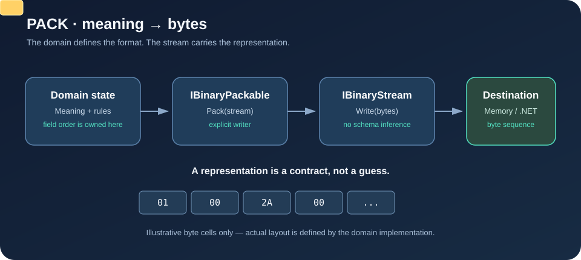
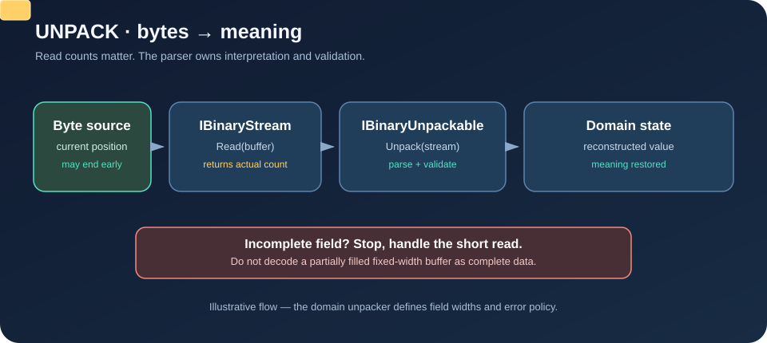

# FSM_Serialization Gallery

FSM_Serialization is the explicit byte boundary between domain meaning and binary representation. This gallery links the runnable proof, architectural explanation, API contracts, and visual walkthroughs.

## Start here

- [README and one-minute tutorial](README.md) — install the published 1.0.0 package and pack/unpack a value; 1.0.1 remains an unpublished documentation candidate.
- [Byte operations: a visual walkthrough](docs/BYTE_OPERATIONS.md) — follow the forward and reverse byte paths.
- [Theory and boundaries](docs/THEORY.md) — why representation, storage, transport, and domain semantics remain separate.
- [Serialization domain inventory](docs/SERIALIZATION_DOMAIN.md) — implemented responsibilities, non-goals, and format-owner obligations.
- [Domain completeness review](docs/DOMAIN_COMPLETENESS.md) — prioritized gaps, ownership boundaries, and the next evidence to build.
- [Test matrix and domain roadmap](docs/TEST_MATRIX.md) — test layers, FSM snapshot questions, security/resource concerns, and benchmark acceptance gates.
- [1.0.1 candidate release notes](docs/RELEASE_NOTES_1.0.1.md) — planned patch scope and release gates.
- [Benchmarking](docs/BENCHMARKING.md) — performance claims and how to reproduce measurements, where available.
- [API class diagrams](docs/UML/) — focused contract diagrams and use cases.

## Living pictures

### Packing: meaning becomes bytes

[Open the packing diagram](docs/images/packing-flow.svg) · [Read the byte walkthrough](docs/BYTE_OPERATIONS.md#packing-forward)

### Unpacking: bytes become meaning

[Open the unpacking diagram](docs/images/unpacking-flow.svg) · [Read the byte walkthrough](docs/BYTE_OPERATIONS.md#unpacking-reverse)

## What this package does—and does not do

It provides explicit pack/unpack contracts and byte-stream adapters. A domain type defines field order, encoding, endianness, lengths, versioning, and validation for its own representation. This package does not silently infer object graphs, define a universal schema, choose persistence policy, or provide a transport protocol.

## Evidence boundary

The source and tests are authoritative. A diagram is an explanation of the contract, not proof of behavior by itself. Where a behavior is not defined by the current interfaces or tests, the documentation labels it as a responsibility of the implementing domain type rather than claiming the package supplies it.

---

  

