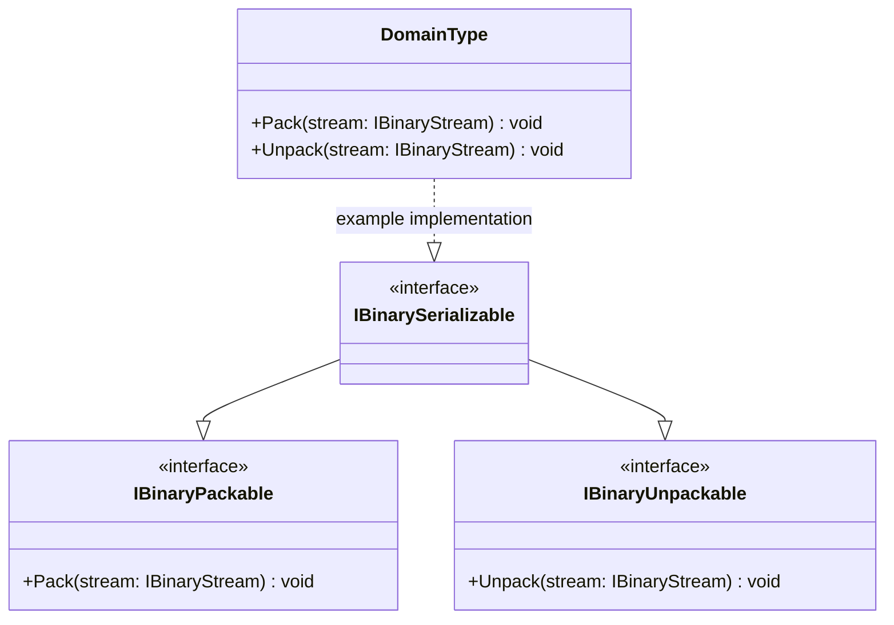

# Binary Contracts — UML Class Card

## Purpose

The contracts deliberately separate writing, reading, and the combined read/write capability. The domain type remains responsible for defining the actual byte layout.

## Class diagram

## Use cases

- Implement only IBinaryPackable when a type needs to emit a representation but does not reconstruct itself.
- Implement only IBinaryUnpackable when a type consumes an existing representation.
- Implement IBinarySerializable when the same type supports both operations.
- Keep format policy beside the type that owns the meaning of each field.

## Important boundary

IBinarySerializable adds no new methods; it combines the two directional contracts. It does not define a default field order, endian convention, string encoding, object graph traversal, schema evolution strategy, or persistence destination.

## Source

- [IBinaryPackable.cs](../../src/IBinaryPackable.cs)
- [IBinaryUnpackable.cs](../../src/IBinaryUnpackable.cs)
- [IBinarySerializable.cs](../../src/IBinarySerializable.cs)
- [Byte operations walkthrough](../BYTE_OPERATIONS.md)
