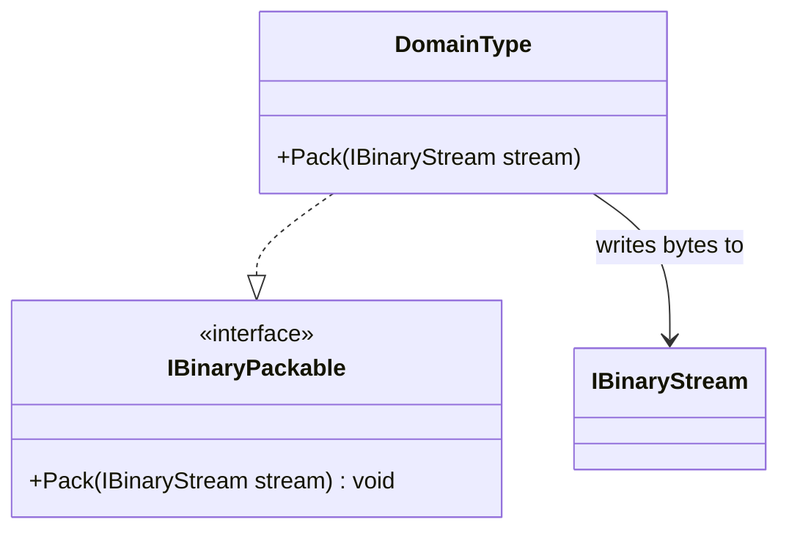

# IBinaryPackable UML

## Class diagram

## Purpose

Defines the one-way capability to write a domain-owned binary representation. The implementation owns field selection, ordering, widths, encoding, and compatibility policy.

## Use cases

- A domain value can be packed but is not responsible for reconstructing itself.
- A writer needs a capability-specific contract without depending on a combined round-trip interface.
- A concrete format test verifies exact bytes and endianness.

## Boundary

This interface does not choose a universal format, allocate storage, or publish bytes to a file, network, database, or cloud service.
