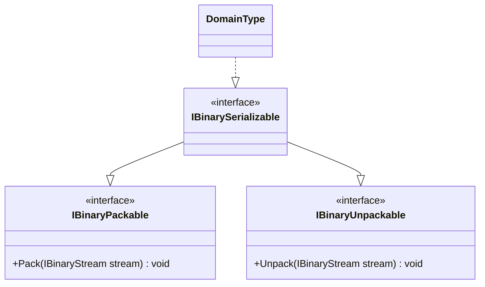

# IBinarySerializable UML

## Class diagram

## Purpose

Combines the pack and unpack capabilities without adding members of its own.

## Use cases

- A domain type supports both producing and reconstructing its binary representation.
- A caller wants to express a round-trip capability explicitly.
- A test checks that a type can pack bytes and reconstruct an equivalent value.

## Boundary

The interface does not imply that every serialized value is reversible, compatible across versions, or governed by one package-defined schema. Those guarantees must be defined by the concrete domain format.
