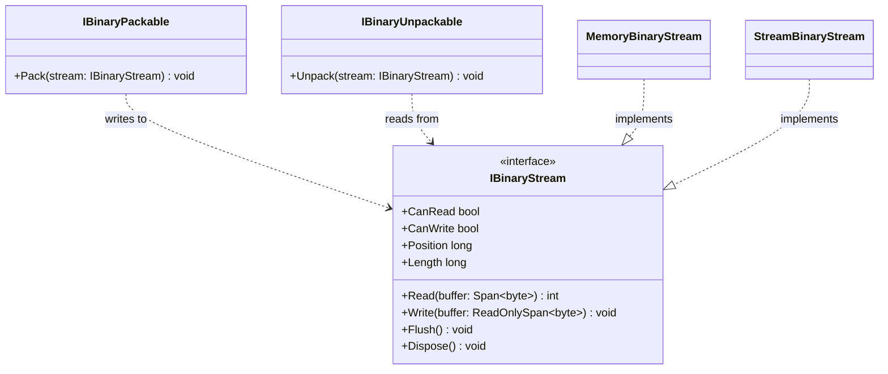

# IBinaryStream — UML Class Card

## Purpose

IBinaryStream is the byte-oriented stream boundary used by the packing and unpacking contracts. It exposes capabilities, position, length, span-based reads and writes, flushing, and disposal.

## Class diagram

## Use cases

- A packer writes a type's explicitly defined representation to an IBinaryStream.
- An unpacker reads from the current stream position and interprets bytes according to its own format.
- A test uses MemoryBinaryStream for deterministic in-memory round trips.
- An integration wraps a .NET Stream with StreamBinaryStream when the stream's supported operations match the consumer's needs.

## Contract notes

Read returns a byte count and may return fewer bytes than requested. Position and Length are exposed by the abstraction, but an implementation may delegate to a stream that does not support those operations. Dispose on StreamBinaryStream disposes the supplied underlying stream.

## Source

- [IBinaryStream.cs](../../src/IBinaryStream.cs)
- [MemoryBinaryStream.cs](../../src/MemoryBinaryStream.cs)
- [StreamBinaryStream.cs](../../src/StreamBinaryStream.cs)
- [Byte operations walkthrough](../BYTE_OPERATIONS.md)
