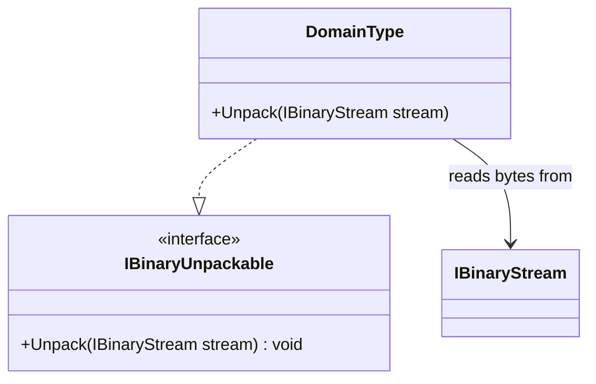

# IBinaryUnpackable UML

## Class diagram

## Purpose

Defines the one-way capability to reconstruct domain-owned state from a byte representation.

## Use cases

- A consumer reads a value from an existing byte stream.
- A format implementation validates required fields and rejects truncated or malformed input.
- A reader-only type avoids claiming it can produce the same representation.

## Boundary

Read may return fewer bytes than requested. Implementations must handle partial reads and end-of-stream according to their concrete format. This interface does not provide schema negotiation or transactional rollback of partially mutated state.
