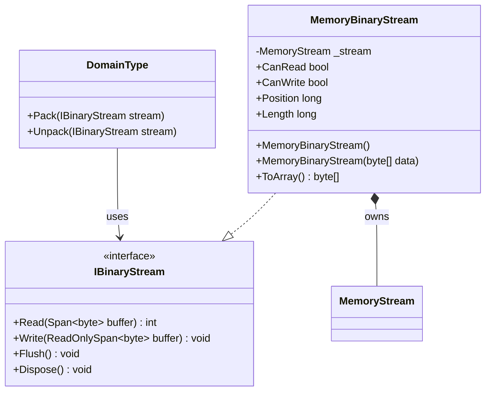

# MemoryBinaryStream UML

## Class diagram

## Purpose

Provides a seekable in-memory implementation of the byte-stream contract. The initial-data constructor copies the supplied bytes and resets the position to zero.

## Use cases

- A small representation is assembled or parsed in memory.
- Tests assert exact output bytes without filesystem or network dependencies.
- A caller needs seeking, overwriting, and access to a copy of the current contents via `ToArray()`.

## Ownership and behavior

The implementation owns its internal `MemoryStream`. Disposing the adapter disposes that stream. The current implementation reports read/write support and delegates position, length, read, write, and flush behavior to `.NET MemoryStream`.
