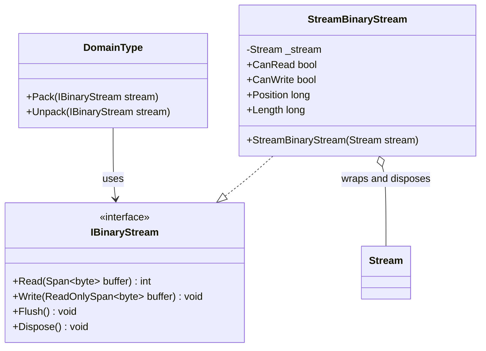

# StreamBinaryStream UML

## Class diagram

## Purpose

Adapts a supplied .NET `Stream` to `IBinaryStream`, forwarding operations and capability flags without adding a buffer or format interpretation.

## Use cases

- A domain type uses a file, network, or other .NET stream through the package's byte contract.
- Existing stream capability flags must remain visible to callers.
- The caller wants the same pack/unpack contract to work over memory-backed and externally supplied streams.

## Ownership and behavior

The constructor rejects null. Disposing `StreamBinaryStream` disposes the wrapped stream. Short reads are preserved; the adapter does not fill the destination buffer. Operations such as `Position` and `Length` may throw when the underlying stream does not support them.
