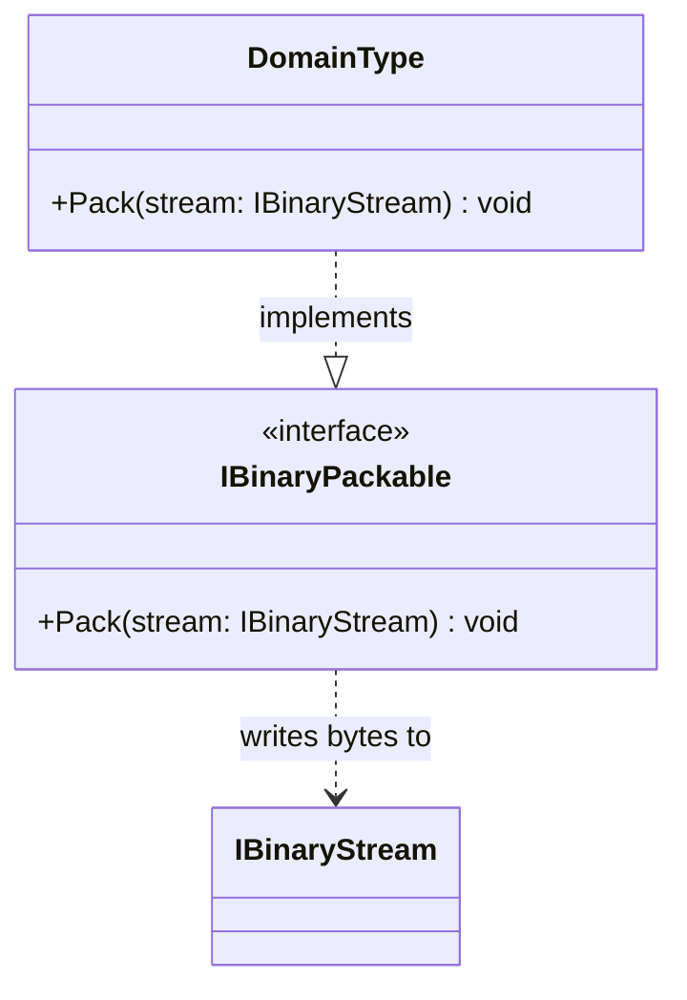

# IBinaryPackable

**Purpose:** declares the write direction of a domain-owned binary representation.

## UML class card

## Use cases

- A domain type emits a representation without committing to a package-wide object graph format.
- A producer exposes only the write capability it needs.

## Contract boundary

Pack defines no universal field order or encoding. The implementing type owns the bytes' meaning and must define its format. See [Byte Operations](../docs/BYTE_OPERATIONS.md#packing-forward) and [source](IBinaryPackable.cs).
