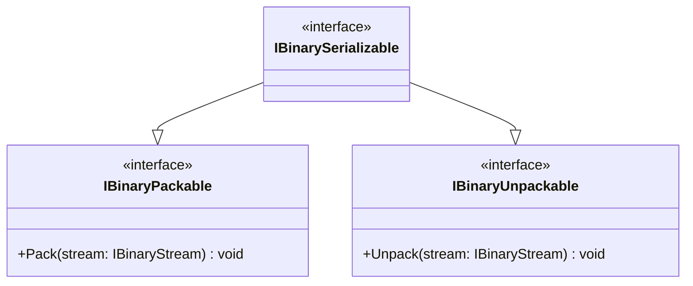

# IBinarySerializable

**Purpose:** combines the pack and unpack contracts for a type that supports both directions.

## UML class card

## Use cases

- A domain-owned value is both written and reconstructed.
- A test exercises a full round trip through IBinaryStream.

## Contract boundary

The interface adds no members and does not define a universal format. It simply combines two capabilities. See [source](IBinarySerializable.cs).
