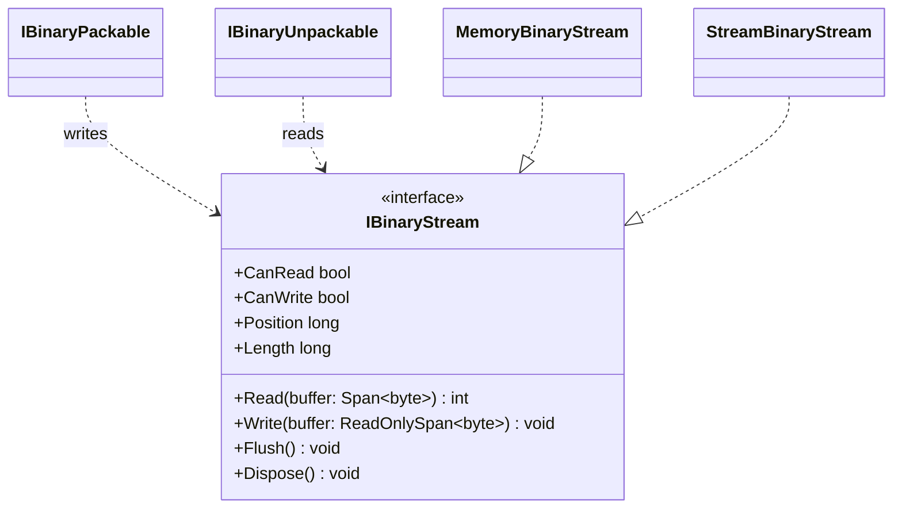

# IBinaryStream

**Purpose:** defines the byte-oriented operations used by packers and unpackers.

## UML class card

## Use cases

- Share one byte-oriented contract across domain packers and unpackers.
- Use the in-memory adapter for tests or wrap a .NET Stream for integration.

## Contract boundary

Read returns the actual byte count; Position and Length can fail if the underlying stream does not support them. See [full UML card](../docs/UML/IBinaryStreamUML.md) and [source](IBinaryStream.cs).
