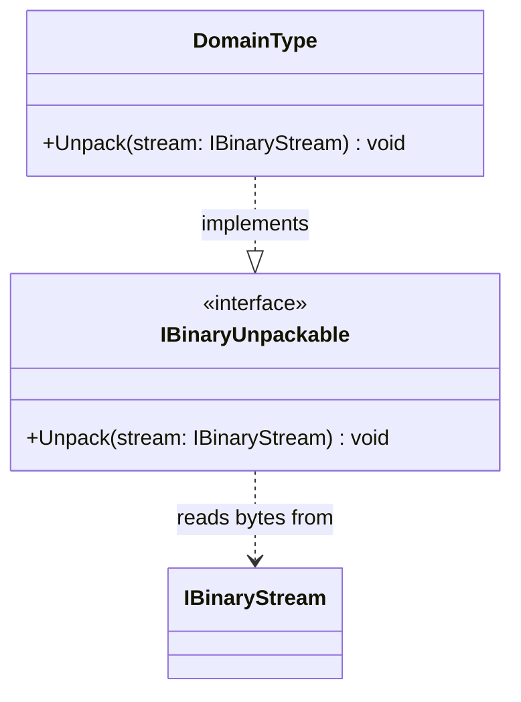

# IBinaryUnpackable

**Purpose:** declares the read direction of a domain-owned binary representation.

## UML class card

## Use cases

- A type reconstructs its state from a representation defined by its domain contract.
- A read-only consumer avoids advertising a write capability it does not need.

## Contract boundary

Read may return fewer bytes than requested. The implementation must handle short reads, malformed input, and format-specific validation. See [Byte Operations](../docs/BYTE_OPERATIONS.md#unpacking-reverse) and [source](IBinaryUnpackable.cs).
