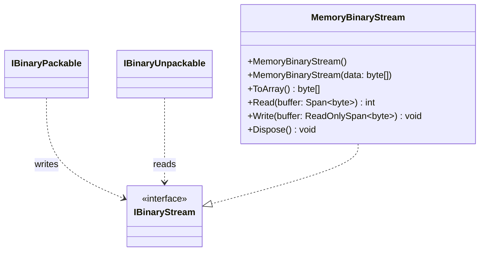

# MemoryBinaryStream

**Purpose:** supplies a memory-backed IBinaryStream.

## UML class card

## Use cases

- Test pack/unpack implementations without filesystem or network dependencies.
- Inspect the resulting byte sequence using ToArray.
- Initialize from a byte array and read from position zero.

## Ownership and behavior

The constructor copies initial data into its internal MemoryStream. The instance supports reading and writing and disposes its internal stream when disposed. See [source](MemoryBinaryStream.cs).
