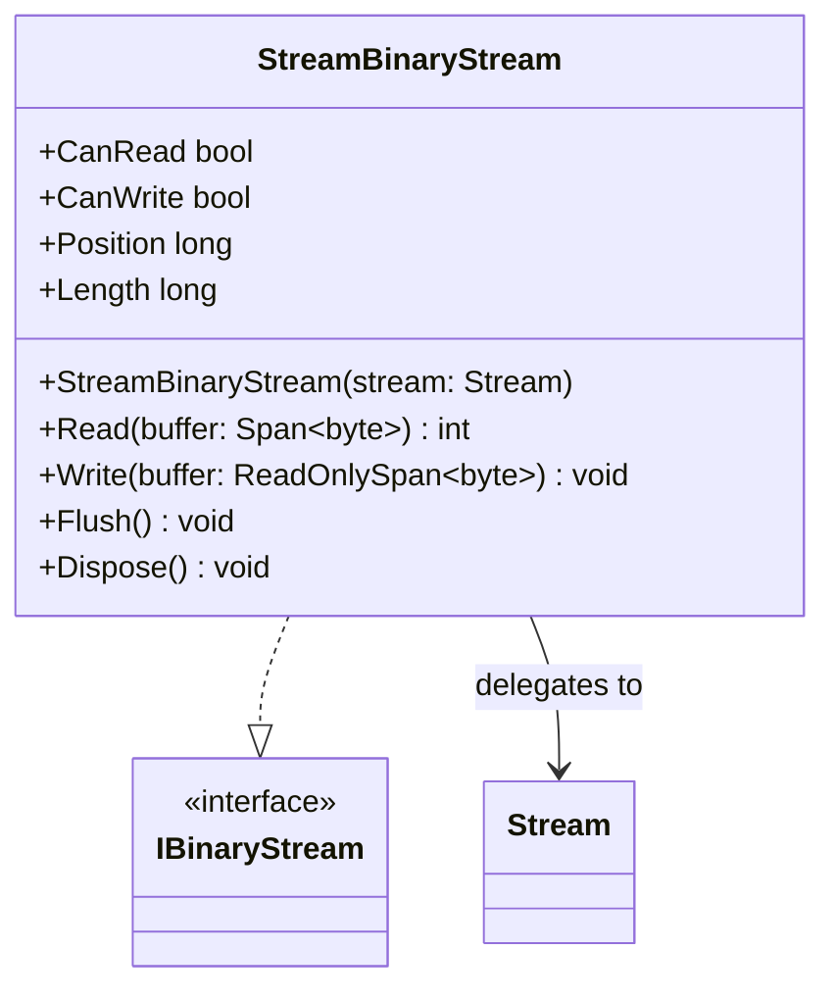

# StreamBinaryStream

**Purpose:** adapts a .NET Stream to IBinaryStream without adding a format layer.

## UML class card

## Use cases

- Integrate an existing .NET stream with the package's byte-oriented contracts.
- Reuse the underlying stream's read/write capabilities and position semantics.

## Ownership and behavior

The adapter delegates operations and capability properties to the supplied stream. Disposing the adapter disposes that underlying stream. Position and Length may throw if the underlying stream does not support them. See [source](StreamBinaryStream.cs).
